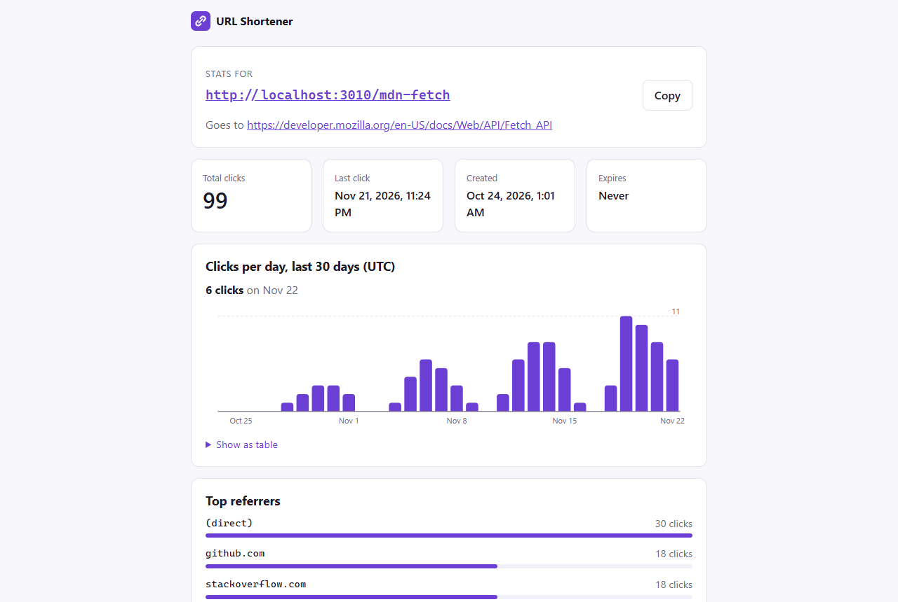
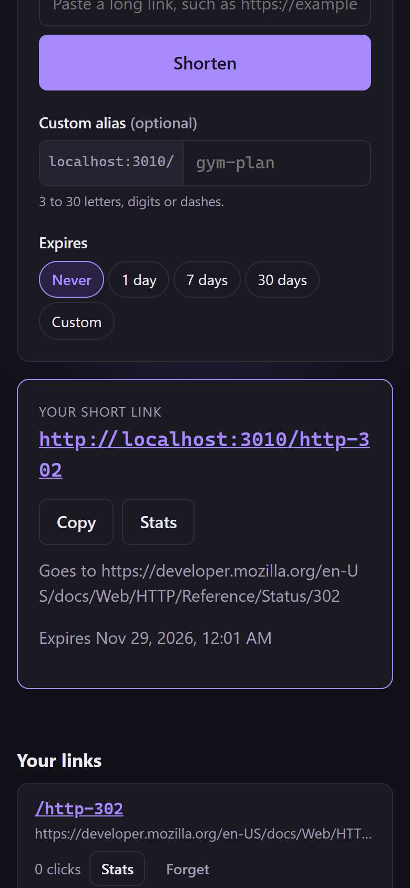

# URL Shortener

Paste a long link, get a short one, and see how often it is clicked, on which days, and from where.

**Live:** https://url-shortener-ofb3.onrender.com/

> This is a demo on Render's free tier. After about 15 minutes without visitors it goes to sleep, so the first visit can take up to a minute. Its disk is wiped on every restart, so links you make disappear and the six sample links load again.

<p>
  
  
</p>

Project 3 of a full-stack practice series. The new skill here is automated API tests with Vitest and Supertest.

## Features

- Shorten any `http` or `https` link to a random 7-character code, or pick your own alias (3 to 30 letters, digits or dashes).
- Optional expiry: never, 1 day, 7 days, 30 days, or a custom date. An expired link answers `410 Gone` with a small page that says so.
- Redirects are `302` with `Cache-Control: no-store`, so the browser asks again on every visit and every visit is counted once.
- A stats page per link: total clicks, last click, a 30-day bar chart (also as a table), and the top five referring sites.
- "Your links" lists the links made in this browser, with their click counts; it lives in `localStorage`, so there are no accounts.
- Refuses `javascript:`, `data:` and other non-web links, `localhost`, bare IP addresses, links over 2,048 characters, and links back to the shortener itself.
- At most 20 new links per visitor per minute. Visitors are told apart by IP address in memory only; no IP address is ever stored.
- Light and dark themes follow the system setting, and the layout works on a phone.

## Stack

| Part | Tools |
| ---- | ----- |
| Language | TypeScript on both sides |
| Client | React 19, Vite, an SVG chart with no chart library, oxlint |
| Server | Node, Express 5, Zod 4, `helmet`, `express-rate-limit`; Node runs the `.ts` files directly, and `tsc --noEmit` checks them |
| Database | SQLite through `better-sqlite3`: a `links` table and a `clicks` table with one row per visit |
| Tests | Vitest and Supertest, run in GitHub Actions on every push |
| Hosting | Render free web service; Express serves the built client |

## API

| Method | Route | Does |
| ------ | ----- | ---- |
| `POST` | `/api/links` | Create a link from `{ url, alias?, expiresAt? }`; returns `201` with `{ code, url, createdAt, expiresAt }` |
| `GET` | `/api/links/:code` | The link with `totalClicks`, `lastClickAt`, `daily` (30 days, oldest first) and `referrers` (top five); `404` if unknown |
| `GET` | `/:code` | `302` to the long link and one click recorded; `404` page if unknown, `410` page if expired |
| `GET` | `/stats/:code` | The stats page of the client |

Errors from the API are JSON:

| Status | When |
| ------ | ---- |
| `400` | Bad input, with `{ error, issues: [{ field, message }] }` |
| `404` | No link with that code |
| `409` | The alias is taken |
| `413` | A request body over 16 kB |
| `429` | More than 20 new links, or more than 60 stats lookups, in a minute |

Codes and aliases are case-sensitive. `api`, `assets`, `stats`, `favicon` and `robots` are reserved, so they never clash with the app's own addresses. Times are UTC.

## Security

- **Security headers** from `helmet` on every answer: the API, the app, the redirects and the `404` and `410` pages. The Content-Security-Policy lets scripts, styles, images and requests come only from this site, and `Referrer-Policy: no-referrer` means the site a short link leads to is not told which short link was followed.
- **Only web links.** `http` and `https` on a real domain name; `javascript:`, `data:`, `localhost`, bare IP addresses and links back to the shortener itself are refused.
- **Google Safe Browsing.** Each new link is checked with the v5 Lookup API, and a link listed as phishing, malware or unwanted software is refused with a `400`. Every visit checks again, so a site that turns bad later stops redirecting and gets a `410` page that names no address. Clean answers are cached for an hour (unsafe ones for as long as Google says), at most 1,000 at a time. If Google cannot be reached within 2 seconds, a new link is refused with a `503` and `Retry-After`, and the form shows a "Service temporarily unavailable" notice banner, so nothing unchecked is shortened; existing links keep redirecting, since they were checked when made. The key is `SAFE_BROWSING_API_KEY`, sent in a header; without it nothing is checked and the server logs a warning.
- **Limits per visitor and minute:** 20 new links and 60 stats lookups. Stats are public to anyone with the code, so the lookup limit stops a script from guessing codes to read them; redirects are not limited. Request bodies are capped at 16 kB.
- **Input** is checked with Zod before any SQL runs, and every query uses placeholders, never pasted text.

## Run it locally

Needs a Node version that runs TypeScript files directly (22.18 or later; the repo pins 26 in `.node-version`).

```bash
git clone https://github.com/Sanbogukai/url-shortener.git
cd url-shortener
cd server && npm install && npm run seed && cd ..
cd client && npm install && cd ..
```

Then in two terminals:

```bash
cd server && npm run dev    # API and redirects on http://localhost:3000
```

```bash
cd client && npm run dev    # app on http://localhost:5173
```

`npm run seed` adds six sample links with a month of clicks, including the alias `/mdn-fetch` and the expired `/old-promo`; it does nothing if the database already has links. The database file is `server/links.db`; set `DB_PATH` to use another file, and `SEED_IF_EMPTY=1` to seed on start.

### Production build

```bash
cd client && npm run build && cd ../server && npm start
```

Express then serves the app, its files and the short links from one address.

## Tests

```bash
cd server && npm test
```

101 tests in 9 files cover every route and every error status (`400`, `404`, `409`, `410`, `429`):

- creating links with codes and aliases, and every way a create is refused;
- the Safe Browsing check: caching, the key in a header, the `503` when the check cannot run, the bounded cache, refused creates and blocked redirects;
- redirects: the `302`, the `no-store` header, one click per visit, referrers, and the `404` and `410` pages;
- stats: the 30-day chart with empty days filled in, expiry, and the top referrers;
- code collisions, with a fake code generator that returns a taken code first;
- the rate limits, including that they count the visitor and not a proxy or a forged header, and that the lookup limit never blocks redirects;
- the security headers on the API, the `404` page and the redirects;
- the built client served beside the short links, and the seed data.

`createApp()` takes the database, the clock and the code generator as options. Each test gets a fresh in-memory database and a fixed clock, so expiry and the chart are deterministic and the tests never share state.

Checks: `npm run typecheck` in `server/` and `client/`, and `npm run lint` in `client/`. GitHub Actions runs all of them, plus the client build.

## Deploy notes

Render runs the build `cd client && npm ci && npm run build && cd ../server && npm ci` and starts with `cd server && npm start`, with `SEED_IF_EMPTY=1` so the demo is never empty.

Requests reach the app through three proxies: Cloudflare, Render's internal load balancer, and a local proxy on the same machine. Express is set to `trust proxy 3` so `req.ip` is the visitor. With fewer hops it was a proxy address that changed from request to request, which split one visitor's limit over several counters and let 22 creates through in a minute. The right number came from a temporary route that echoed the real `X-Forwarded-For` header, not from guessing.
